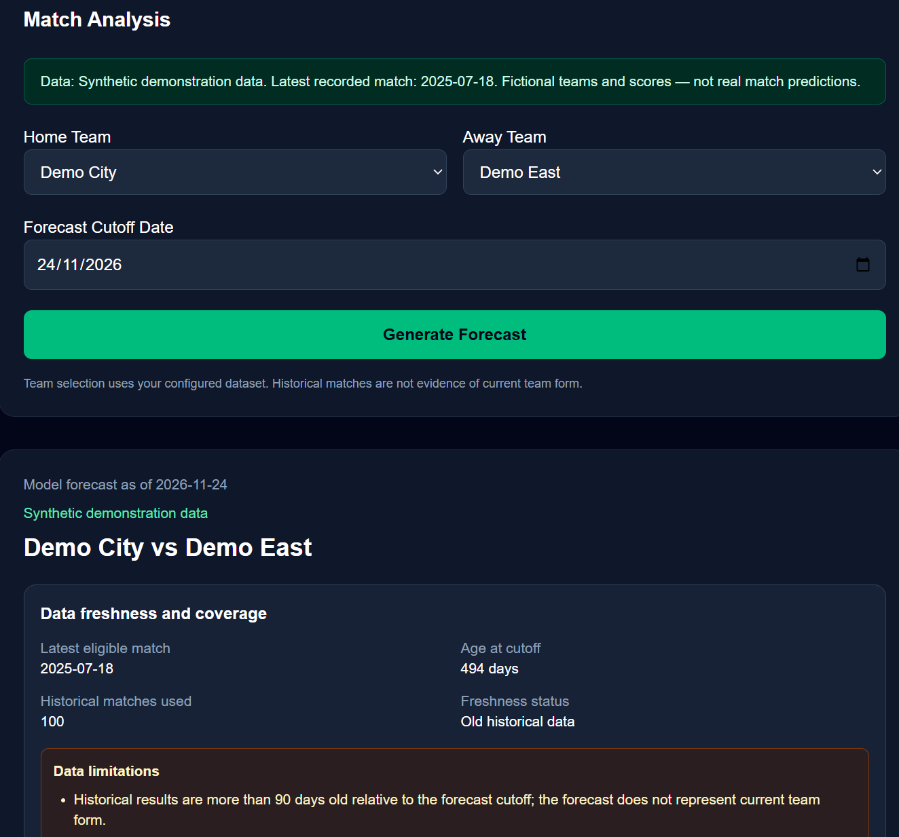
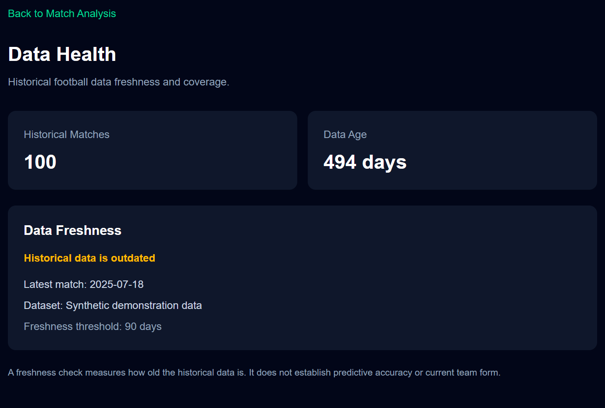

# AnalyzNow AI

**Football intelligence · Statistical forecasting · Bookmaker market analysis**

AnalyzNow AI is a football research application that turns historical match results into probabilistic forecasts and supports separate retrieval of bookmaker-implied market probabilities, without blending them into the statistical forecasts. The project combines a Python forecasting engine, PostgreSQL, FastAPI and a Next.js dashboard.

**Status:** Working local research application under active development. Forecasting, database integration, the web dashboard, model diagnostics and Data Health have been exercised. The repository is intended as a **source-code engineering portfolio**, not a public forecasting service; no live application is deployed. Forecasts are not validated for betting or commercial decision-making.

## What the application does

| Capability | Current status |
| --- | --- |
| Historical Premier League data ingestion and source snapshots | Four seasons (2021/22–2024/25) imported to the local PostgreSQL example; five seasons (2021/22–2025/26) evaluated in separate local research snapshots |
| PostgreSQL storage and SQL queries | Implemented; 1,520 match records across 26 clubs in the local dataset |
| Independent-Poisson forecasting model | Implemented; expected goals, match outcome and goal-market probabilities |
| Forecast data transparency | Forecast responses show latest eligible match, age, historical sample size and explicit stale/low-data warnings |
| Walk-forward historical evaluation | Implemented; Poisson, Elo and 50/50 ensemble compared across 2024/25 and 2025/26 (380 fixtures per season); later-season settings were fixed in advance |
| FastAPI forecasting endpoint | Implemented and exercised with PostgreSQL data |
| Next.js interactive forecasting dashboard | Historical/synthetic forecasting and dataset-aware team selectors implemented; Model Quality page and Data Health dashboard integrated into `main` via PRs #8 and #9 |
| Current bookmaker odds retrieval and margin normalization | Implemented; API endpoint and calculation tests passing |
| Bookmaker odds dashboard | Separate draft PR #5; not merged into `main`. Current bookmaker odds are not time-aligned with the historical forecasting models |
| Model benchmarking and diagnostics | Elo, ensemble, probability calibration, clustered uncertainty intervals and split-season diagnostics merged via research PR #8; active forecast remains Poisson | 
| Verified team news, RAG, LangGraph match analysis | Planned |
| Public deployment, authentication and production monitoring | Not yet implemented |

The current Poisson model uses **historical final scores**, not a full expected-goals (xG) event dataset. Its numerical output is separate from bookmaker odds. No combined model or profitable betting edge has been established.

## Technology

- **Backend and modelling:** Python, FastAPI, Pydantic, pytest, independent-Poisson forecasts, Elo ratings, walk-forward backtesting and exploratory model ensembles.
- **Data:** PostgreSQL 17, Psycopg, SQL, Docker Compose, OpenFootball historical results.
- **Frontend:** Next.js, React, TypeScript, Tailwind CSS.
- **Market data:** The Odds API, bookmaker margin normalization and multi-bookmaker summaries.
- **Engineering:** Git, GitHub Actions, full-stack Docker image and Compose configuration (pending container integration verification), documented source provenance and automated checks.

Refer to [System Architecture](docs/ARCHITECTURE.md), [Development Roadmap](docs/ROADMAP.md), [Model Quality](docs/MODEL_QUALITY.md), [Technical Research](docs/RESEARCH.md) and [Contribution Standards](CONTRIBUTING.md). Documentation is reviewed alongside each verified feature milestone; roadmap status is not changed until tests and evidence support it.

## Quick local demonstration

For a no-credentials walkthrough using **fictional match data**, see [Reproducible Local Demo](docs/DEMO.md). It uses the included synthetic CSV and does **not** reproduce real-match evaluation or live bookmaker odds. The team selector and source-label changes passed automated CI. On 2026-11-24, the developer also verified a separate clean GitHub checkout in a fresh local folder: a synthetic forecast rendered in the browser, and the `/model-quality` page displayed the historical aggregates. See the [Public Release Checklist](docs/PUBLIC_RELEASE_CHECKLIST.md) for outstanding public-release gates.

The Data Health dashboard (`http://127.0.0.1:3011/data-health` when running locally) displays the configured dataset, historical match count, latest match date, and a warning when data is more than 90 days old. This threshold is informational, not a measure of predictive accuracy. The page reads the local FastAPI service on demand; an external monitoring service is not required.

## Application screenshots

The images below show a **local demonstration with fictional teams and match data**. They are not real-world predictions or evidence of forecasting accuracy.

**Forecast transparency:** the match analysis screen displays the historical cutoff, eligible match count, data age and explicit stale-data warning.



**Data Health:** the separate dashboard reports historical match coverage, the latest eligible match date and the data-freshness status.



## Full-stack Docker demonstration

A separate containerized environment runs **PostgreSQL, a fictional-data loader, FastAPI and Next.js** without modifying the historical database or the original `compose.yaml`. Use Docker Desktop and a local `.env` with `POSTGRES_PASSWORD` configured:

```powershell
docker compose -f compose.demo.yaml up --build -d --wait
docker compose -f compose.demo.yaml ps
```

Open http://127.0.0.1:3011 and confirm the team source is labeled **Synthetic demonstration data**. The application should show fictional Demo clubs, not real betting forecasts. Stop with `docker compose -f compose.demo.yaml down` (without `-v`). See [Container Deployment](docs/CONTAINER_DEPLOYMENT.md) for safe first-run setup, verification, limits and troubleshooting.

The isolated Docker environment passed both GitHub Actions integration checks and developer-local synthetic HTTP tests on 2026-11-24. This verifies local demo behavior, not production deployment.

## Browser end-to-end testing

Four Playwright Chromium tests exercise the synthetic-data forecast, network failure handling, and dashboard navigation. All four passed locally on 2026-11-24 against the isolated Docker application. The dedicated GitHub Actions browser workflow must also pass before this feature is considered integrated. See [Browser Testing](docs/BROWSER_TESTING.md) for reproducible setup and its limitations.

## Local development (Windows)

### Requirements

Python 3.11 or later, Docker Desktop, Node.js 20.9 or later, npm, Git and VS Code. Use PowerShell from the repository root unless otherwise indicated.

### 1. Python environment

```powershell
py -3 -m venv .venv
.\.venv\Scripts\python.exe -m pip install -e ".[dev]"
.\.venv\Scripts\python.exe -m pytest -q
```

On 2026-11-24, the developer ran the updated local standard suite: **88 Python tests passed**, with one non-blocking third-party deprecation warning. Frontend lint and the Next.js production build also passed, including the Data Health page. At PR #9 head `9208e70`, GitHub Actions passed all six jobs: Python tests, frontend lint/build, full-stack synthetic demo, Python/npm dependency audits, and reachable-history secret scanning. PR #9 was merged into `main` as commit `9622f8b`. Model Quality research PR #8 was merged into `main`. Separately, the developer previously verified **2 PostgreSQL integration tests** with the restored local 1,520-match database. CI does not reproduce the complete external-data research pipeline or verify all rendered browser interactions.

### 2. Local configuration and PostgreSQL

**Existing installations:** Read [Local Database Migration](docs/DATABASE_MIGRATION.md) before starting Docker with updated identifiers. Changing the Compose project name does not rename or transfer an existing PostgreSQL volume.

If `.env` does not already exist, copy `.env.example` to `.env` and replace the password placeholder with your own local development password. **Existing local installations:** the PostgreSQL account and Compose project must be migrated before switching to the new database identifiers. Follow [Database Migration](docs/DATABASE_MIGRATION.md) rather than replacing a working `.env` or deleting a volume.

```powershell
if (-not (Test-Path .env)) { Copy-Item .env.example .env }
# Edit POSTGRES_PASSWORD in .env before starting a NEW database.
docker compose up -d
docker compose ps
```

The database is bound to `127.0.0.1:5433` for local use. The database container stores its files in a Docker volume. Never commit `.env` or API credentials.

### 3. Historical results and schema

For a new database, create its tables:

```powershell
docker compose cp database/schema.sql postgres:/tmp/schema.sql
docker compose exec -T postgres psql -U analyznow -d analyznow -v ON_ERROR_STOP=1 -f /tmp/schema.sql
```

Retrieve completed Premier League results and verify the saved snapshot:

```powershell
.\.venv\Scripts\python.exe -m football_intel fetch-openfootball --as-of 2025-07-01
.\.venv\Scripts\python.exe -m football_intel verify-snapshot data\openfootball\epl_2021_2025
```

Import the processed results into PostgreSQL:

```powershell
docker compose cp "data\openfootball\epl_2021_2025\processed\epl_2021-22_2022-23_2023-24_2024-25.csv" postgres:/tmp/epl_matches.csv
docker compose cp database/import_matches.sql postgres:/tmp/import_matches.sql
docker compose exec -T postgres psql -U analyznow -d analyznow -v ON_ERROR_STOP=1 -f /tmp/import_matches.sql
```

For the specified four seasons, the expected count is **1,520 completed matches**, provided all source seasons are complete. Importing again updates matching fixture scores instead of inserting duplicate fixtures. More detail is available in [Data Pipeline](docs/DATA_PIPELINE.md). Do not repeat imports unnecessarily on an existing working database.

### 4. FastAPI backend

In a PowerShell terminal at the repository root:

```powershell
$env:FOOTBALL_DATA_SOURCE = "postgres"
.\.venv\Scripts\python.exe -m uvicorn football_intel.api:app --host 127.0.0.1 --port 9011
```

Open [FastAPI documentation](http://127.0.0.1:9011/docs). Example request for `POST /v1/forecast`:

```json
{
  "home_team": "Arsenal FC",
  "away_team": "Chelsea FC",
  "as_of": "2025-07-01"
}
```

This is a historical model demonstration based on data available before the cutoff, **not** a current Arsenal–Chelsea match prediction.

### 5. Next.js frontend

Inside `frontend`, create `.env.local` with:

```dotenv
FOOTBALL_API_URL=http://127.0.0.1:9011
```

In a **separate** PowerShell terminal:

```powershell
cd frontend
npm.cmd ci
npm.cmd run lint
npm.cmd run dev -- --hostname 127.0.0.1 --port 3011
```

Open [AnalyzNow AI dashboard](http://127.0.0.1:3011). The team selector reflects the configured data source. Keep the PostgreSQL container and FastAPI terminal running when using the historical database, or follow the synthetic demo guide instead.

## Forecast freshness and limitations

The forecast dashboard now shows a per-request **Data freshness and coverage** panel. The backend calculates this from completed matches strictly before the selected cutoff date, reports the latest eligible match and count, and warns when the latest match is more than **90 days** before the cutoff. It also surfaces low-data and unseen-team limitations. The 90-day threshold is a transparency heuristic, **not** evidence of forecast accuracy or a guarantee that newer results are reliable.

These indicators neither download current results nor modify forecast probabilities. In particular, a recent cutoff with old historical data remains an old-data forecast. See the `data_quality` object returned by `POST /v1/forecast`.

## API overview

| Method | Route | Purpose |
| --- | --- | --- |
| `GET` | `/health` | Basic development server status (not a database readiness check) |
| `POST` | `/v1/forecast` | Generate a statistical forecast for teams and cutoff date |
| `GET` | `/v1/teams` | List teams and the configured dataset label for the dashboard |
| `GET` | `/v1/market-odds` | Retrieve current EPL bookmaker-implied market probabilities |
| `GET` | `/v1/data-health` | Report historical match coverage, latest recorded match, and data freshness |

Market odds access requires `ODDS_API_KEY` in the local `.env`. Run `python -m football_intel.market_odds` to inspect the provider response; this consumes provider API quota. The default-branch dashboard displays statistical forecasts. The live market dashboard is developed separately in draft PR #5; it is **not merged** into `main`.

## Testing and evaluation

```powershell
.\.venv\Scripts\python.exe -m pytest -q
.\.venv\Scripts\python.exe -m pytest -q tests/integration_postgres.py
```

The second command explicitly runs the PostgreSQL-dependent tests and requires a populated local database.

For a historical evaluation:

```powershell
.\.venv\Scripts\python.exe -m football_intel backtest data\openfootball\epl_2021_2025\processed\epl_2021-22_2022-23_2023-24_2024-25.csv --min-training 380 --test-from 2023-08-01 --output outputs\epl_2023_2025_backtest.json
```

Earlier local Poisson walk-forward testing across 760 Premier League matches reported a **multiclass Brier score of 0.579285**, compared with **0.646967** for a simple league-frequency baseline, and **log loss of 0.975758**, compared with **1.068422** for that baseline.

Research merged via PR #8 evaluated Poisson, Elo and an equal-weight ensemble on **380 matches from 2024/25** (exploratory) and **380 from 2025/26** (parameters chosen in advance). In 2025/26, the respective Brier scores were **0.618784**, **0.627743** and **0.618067**. The ensemble's slight advantage over Poisson had uncertainty intervals including zero. **Poisson remains the application's active forecast model**; the 2025/26 result does not establish that the ensemble is reliably superior. See [Elo Evaluation](docs/ELO_EVALUATION.md), [Held-out Evaluation](docs/HELDOUT_EVALUATION.md) and [Model Quality](docs/MODEL_QUALITY.md).

The read-only `/model-quality` page displays validated **aggregate-only** metrics from the committed `frontend/data/model-quality.json`. For the complete fresh-download procedure, expected match counts, exact evaluation commands and aggregate comparison, see [Historical Model Reproducibility](docs/MODEL_REPRODUCIBILITY.md). On 24 November 2026, the developer independently fetched and verified fresh four- and five-season OpenFootball snapshots, reran the 2024/25 exploratory and 2025/26 later-season model comparisons, and reproduced the published summary scores. These results demonstrate historical reproducibility, not prospective predictive accuracy. The full research journals and external match data are not committed and are **not recreated by ordinary CI**. These results do not establish betting profitability or production forecasting reliability.

## Repository layout

```text
AnalyzNow-AI/
├── database/             PostgreSQL schema and match importer
├── data/                 Synthetic sample and data provenance guidance
├── docs/                 Architecture, roadmap, research, data pipeline
├── frontend/             Next.js dashboard and server-side API proxy
├── src/football_intel/   Forecasting, ingestion, database and market modules
├── tests/                Automated tests and optional database integration checks
├── compose.yaml          Local PostgreSQL service
├── pyproject.toml        Python package configuration
└── README.md             Project overview and setup
```

## Data rights, safety and limitations

- The OpenFootball source repository declares its football results under CC0. Data provenance is retained locally; scores have not all been independently verified.
- Live odds require an external provider API key and remain subject to provider usage and redistribution terms. Do not assume rights to republish commercial odds.
- The local forecasting/database example documents a 2021/22–2024/25 snapshot. Separate, locally downloaded 2025/26 match results were used in research evaluation; neither should be presented as current 2026/27 team-form evidence.
- The independent-Poisson model does not yet account for injuries, suspensions, xG event data, tactical changes or correlated goal scores.
- The application is a local research tool without public-user authentication, production security controls or deployment readiness.
- Forecasts represent uncertainty and are **not betting recommendations or guarantees of profit**. No real-money betting functionality is provided.

## Project direction

Planned work includes separate validation of the market-dashboard branch, time-matched statistical-versus-market comparisons, stronger independent model validation, verified news, retrieval-augmented analysis, automated monitoring, and secure deployment. Each feature will be considered complete only when its tests and results can be independently checked. See the [Development Roadmap](docs/ROADMAP.md).

## License

Project source code is provided under the [MIT License](LICENSE). Third-party football data, bookmaker feeds and other external materials are governed by their own terms.
