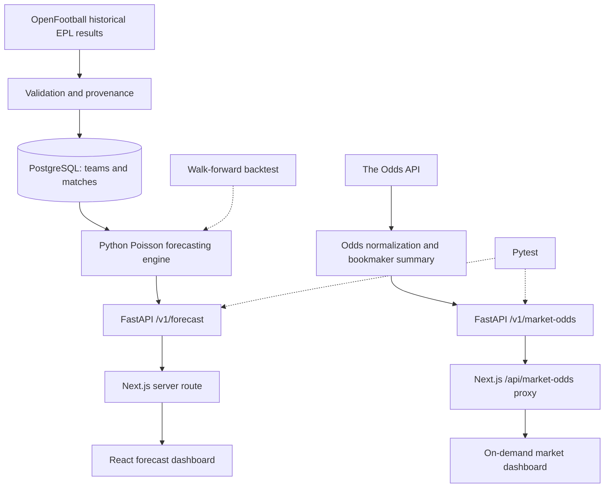
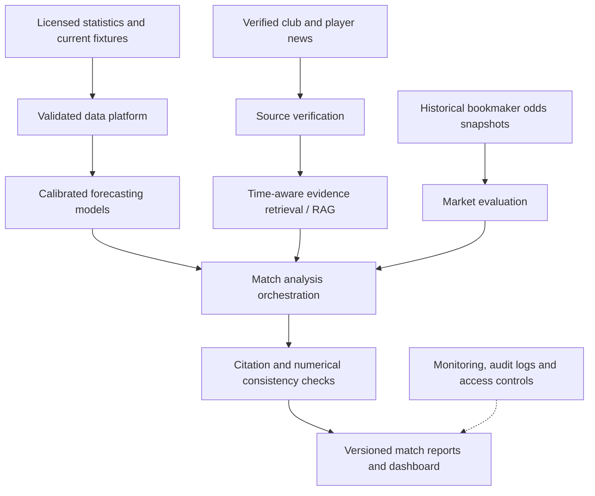

# AnalyzNow AI — System Architecture

## Implemented local system

**Important boundary:** A separate on-demand bookmaker-odds view is implemented on the feature branch, pending end-to-end verification. Historical forecasts and live market probabilities remain separate; the system does not blend their probabilities.

## Data model

`teams` stores a unique club name and generated identifier. `matches` stores the fixture date, references to the home and away clubs, and completed match scores. Uniqueness and nonnegative-score constraints help maintain integrity. The database currently represents completed results, not fixtures with kickoff timestamps, source revisions or multiple competitions.

The Python data access module requests only results with dates **strictly earlier** than the forecast cutoff. The forecast model computes expected goals and a distribution over likely scores, then derives home/draw/away and other goal probabilities.

## HTTP interfaces

- `POST /v1/forecast` accepts home team, away team and an optional historical cutoff date.
- `GET /v1/market-odds` retrieves current EPL bookmaker prices and converts them to margin-normalized 1X2 market probabilities.
- The Next.js frontend calls its local `/api/forecast` server route, which forwards requests to FastAPI.
- The new `/api/market-odds` server route forwards user-triggered bookmaker requests to FastAPI without exposing the provider API key in browser code.
- `GET /health` reports process status; it is not a full database or provider availability check.

## Engineering safeguards

- Forecasts use only data dated before their cutoff, avoiding same-day/future result leakage.
- LLMs must never invent or directly overwrite numerical model probabilities.
- Tests cover API behavior, mathematical functions, historical results, error handling and market-data responses.
- Bookmaker prices and timestamps must be treated as source data, not evidence of a guaranteed advantage.
- API keys and the PostgreSQL password are loaded from local environment configuration and must not be committed.

## Planned architecture

Additional planned capabilities include properly licensed current data, calibrated models, player availability, LangGraph research workflows, pgvector retrieval, saved forecasts, authentication and secure cloud deployment. These are **not** included in the current local application.
