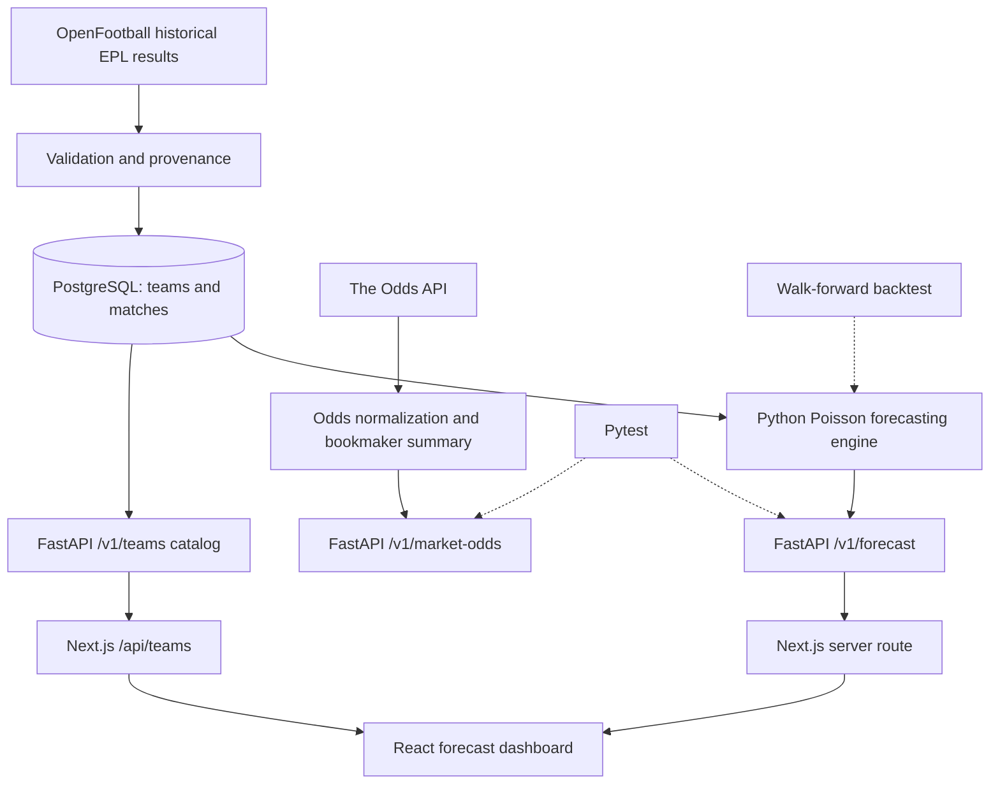
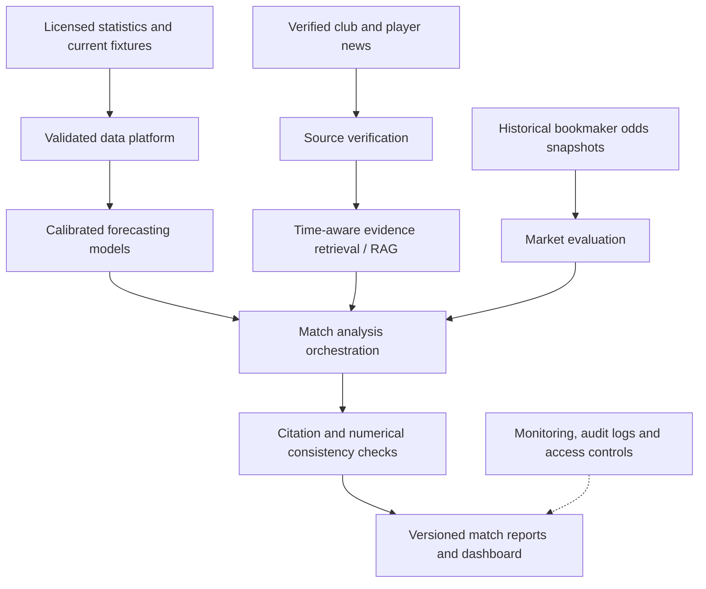

# AnalyzNow AI — System Architecture

## Implemented local system

**Important boundary:** The current market odds API is separate from the historical statistical forecasts. The dashboard does not yet contain a live-odds section, and the system does not blend their probabilities.

## Hosted portfolio demonstration (not yet deployed)

The planned Azure Container Apps layout separates the public Next.js website from an internal-only FastAPI service in the same Container Apps environment. The API reads `data/synthetic_demo.csv` and runs with `ANALYZNOW_PUBLIC_DEMO=1` so bookmaker odds cannot be requested. No hosted PostgreSQL instance is needed. An explicit, manually approved GitHub Container Registry image publishing workflow produces fixed-source-revision images for cloud deployment. The proposed stack remains **unverified in Azure** until a real live URL and full HTTP demonstration are tested. See [Azure Deployment](AZURE_DEPLOYMENT.md).

## Container demonstration (under integration verification)

A separate `compose.demo.yaml` starts a dedicated PostgreSQL database, a one-time guarded loader for the fictional CSV, a FastAPI service, and a Next.js server. The dashboard communicates with FastAPI using `http://api:9011`; FastAPI uses PostgreSQL's internal hostname `postgres:5432`. The database has its own Docker volume and does not share the historical-data Compose project's storage. API and UI endpoints bind to loopback ports 9011 and 3011. See [Container Deployment](CONTAINER_DEPLOYMENT.md).

The production-hosting architecture is not implemented. Container integration will be marked verified only after real Docker build, startup and HTTP smoke checks pass.

## Data model

`teams` stores a unique club name and generated identifier. `matches` stores the fixture date, references to the home and away clubs, and completed match scores. Uniqueness and nonnegative-score constraints help maintain integrity. The database currently represents completed results, not fixtures with kickoff timestamps, source revisions or multiple competitions.

The Python data access module requests only results with dates **strictly earlier** than the forecast cutoff. The forecast model computes expected goals and a distribution over likely scores, then derives home/draw/away and other goal probabilities.

## HTTP interfaces

- `POST /v1/forecast` accepts home team, away team and an optional historical cutoff date.
- `GET /v1/market-odds` retrieves current EPL bookmaker prices and converts them to margin-normalized 1X2 market probabilities.
- The Next.js frontend calls its local `/api/forecast` server route, which forwards requests to FastAPI.
- `GET /v1/teams` supplies the selectable teams and dataset label to the browser via `/api/teams`. The bundled synthetic dataset is explicitly labeled as fictional.
- `GET /health` reports process status; it is not a full database or provider availability check.
- `GET /v1/data-health` reports historical match coverage and freshness. The Next.js `/api/data-health` route forwards this information to the `/data-health` dashboard. This is an on-demand check, not automated monitoring.

## Request diagnostics (under CI verification)

FastAPI middleware generates a unique `X-Request-ID` on each response and writes a JSON access log with route template, HTTP method, status code and request duration. Request bodies, full URL paths, query strings, client-supplied IDs and credentials are never included in that event. Optional OpenTelemetry spans are exported only to the developer console when explicitly enabled; no remote collector is configured. See [API Observability](OBSERVABILITY.md).

## Engineering safeguards

- Forecasts use only data dated before their cutoff, avoiding same-day/future result leakage.
- LLMs must never invent or directly overwrite numerical model probabilities.
- Tests cover API behavior, mathematical functions, historical results, error handling and market-data responses.
- Bookmaker prices and timestamps must be treated as source data, not evidence of a guaranteed advantage.
- API keys and the PostgreSQL password are loaded from local environment configuration and must not be committed.

## Planned architecture

Additional planned capabilities include properly licensed current data, calibrated models, player availability, LangGraph research workflows, pgvector retrieval, saved forecasts, authentication and secure cloud deployment. These are **not** included in the current local application.
