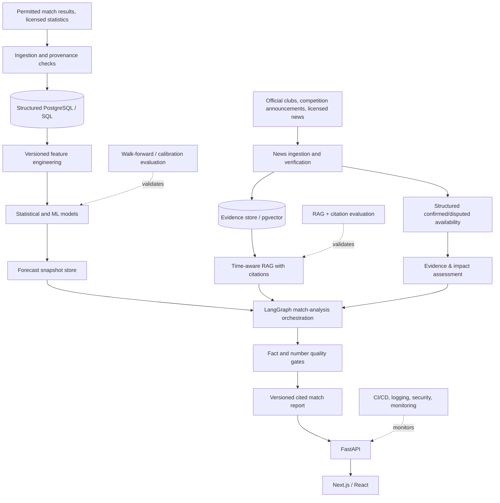

# AnalysNow AI — system architecture (proposed)

## 1. System boundaries

## 2. Invariants

- Forecast probability is a numeric model output, not generated or adjusted directly by an LLM.
- Data rights and provenance recorded before ingestion; forbidden/restricted sources are not ingested.
- Every training feature must have been knowable at the historical cutoff. Versioning includes observed_at and published_at.
- Official confirmed lineup updates are separate snapshots from earlier reports.
- News and retrieved pages are untrusted **data**, not executable prompts/instructions.
- Every substantive claim in a report is traceable to a source or an explicitly identified statistical calculation.
- The product exposes uncertainty; it abstains from unsupported player-impact adjustments.

## 3. First deliverable actually implemented

- Read and validate local completed match CSV (no scraping).
- Build recency-weighted independent-Poisson benchmark on pre-cutoff results.
- Calculate mutually coherent home/draw/away, over/under 2.5, BTTS, top-score probabilities.
- Walk-forward scoring vs pre-cutoff historical league-rate baseline.
- FastAPI development endpoint and automated tests.

Not implemented: PostgreSQL, licensed API ingestion, xG, Elo/Dixon-Coles, player injury model, news/RAG, LangGraph, real-time fixtures/odds, frontend, user auth, production deploy. These are explicit next milestones.

## 4. Planned service contracts (design only)

`Fixture`: fixture_id, competition_id, kickoff_utc, home_team_id, away_team_id, source_id, observed_at.

`HistoricalFeature`: fixture_id, feature_name, feature_value, data_as_of, computed_at, data_version.

`NewsClaim`: claim_id, target_entity_id, source_url, original_source_id, published_at, retrieved_at, event_at, fixture_id, claim_text, status (confirmed/probable/disputed/outdated/unknown), confidence_method.

`ForecastSnapshot`: fixture_id, created_at_utc, cutoff_utc, model_version, feature_snapshot_id, evidence_snapshot_id, markets, limitations, hash.

`Report`: forecast_id, citations, generated_at, verified_at, data_quality_flags, model_disclaimer.

## 5. Forecast accuracy concerns

The initial independent-Poisson baseline assumes goals independent, lacks draw correction, treats match score as the goal input, and is not league- or season-strength calibrated. Multi-league mixes are especially invalid without adjusting for differences in strength/venue. No claims of betting profitability should be made. Next model candidates: calibrated Elo, Dixon-Coles, and feature-based gradient boosting; preserve out-of-time evaluation with independent season holdout and league grouping.

## 6. Future multi-sport design

Use sport-specific `FeatureBuilder`, `Forecaster`, `MarketDefinition` contracts rather than encoding soccer labels in every future module. Do not build these layers yet, until football models are demonstrably reliable.
